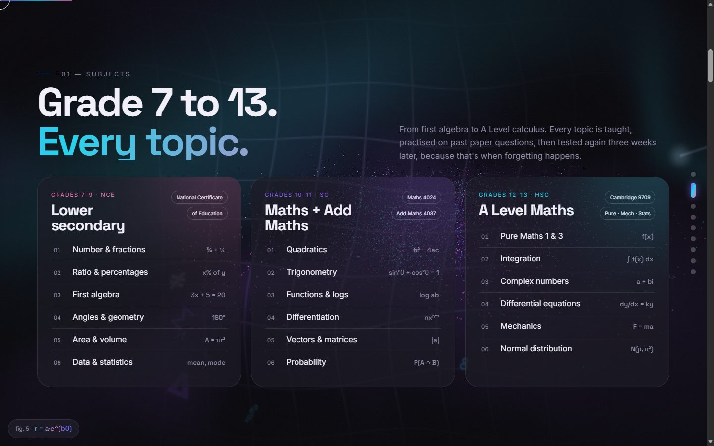

# Kavish Maths

**A 3D, animated three-page website for a Maths tutor in Mauritius: Grades 7–13 (NCE, SC, HSC) and SC Add Maths.**
Particles that morph through real equations, full-screen snap scrolling, a 3D lesson carousel,
an interactive timetable and a booking flow that writes the WhatsApp message for you.

**Live:** https://webluxe.github.io/mercer-maths/ &nbsp;·&nbsp; [Tuition](https://webluxe.github.io/mercer-maths/tuition.html) &nbsp;·&nbsp; [Resources](https://webluxe.github.io/mercer-maths/resources.html)

> **Demo content.** The tutor, results, prices, timetable and reviews are placeholders.
> Portrait photo by Fábio Lucas on Unsplash.


## Three pages

| Profile (`index.html`) | Tuition (`tuition.html`) |
|---|---|
|  |  |
| The tutor, results with a grade chart, the story, reviews, contact | Grades 7–13 by stage (NCE, SC, HSC), timetable, how lessons work, a worked example, quiz, fees, FAQ |

| Resources (`resources.html`) | |
|---|---|
|  |  |
| Revision notes (PDF) and video lessons, filterable by grade stage | Videos load only when you press play (privacy-friendly YouTube embed) |

Switching tabs plays a five-bar page transition; the next page builds itself out of it.

## Chapters and notes

The Resources page lists every chapter for Grades 7–13: Grade 7, Grade 8, Grade 9 NCE, O Level Maths 4024, Add Maths 4037 and A Level 9709 (Pure 1, Pure 3, Mechanics, Statistics). A chapter opens its notes in a reader on the page (PDF.js), so notes work on phones too.

- **Chapters** are listed in `tools/syllabus.cjs`.
- **Kavish's notes:** put the PDF in `assets/notes/<course>/` named like the chapter (e.g. `assets/notes/o-maths/16-variation.pdf`), or list any file name in that chapter's `files`. Then run `npm run build`, which prints which chapters have notes.
- **Demo notes** are written in `tools/notes-demo/<course>.json`. Run `npm run notes` to turn them into PDFs (needs Edge or Chrome).
- **Every other chapter** gets a labelled two-page sample PDF, made by the build.

## Adding videos

Videos come from **`assets/data/resources.json`**. Upload to YouTube (unlisted works), then set `"youtube"` to the video ID, the part after `watch?v=`. An empty `youtube` shows as *Coming soon*. `band` is one of `7-9`, `10-11` or `12-13`.

## Highlights



| | |
|---|---|
|  |  |
| **3D carousel.** Cards on a spinning cylinder, one card per scroll. | **Timetable.** Filter by grade band (cards flip in 3D), tap a slot to book it. |
|  |  |
| **Quiz.** Three real Add Maths questions with worked answers. | **Booking.** Three steps, then a ready-to-send WhatsApp or email. |

**Everything else:**
- **Live 3D background:** aurora light, a rippling graph-paper grid, shooting stars and floating maths symbols.
- **Particle shapes:** a sphere, a torus knot, z = sin x · cos y, a saddle, a spiral, and the words "A*", "KS" and "π". Each section owns one finished shape, and arriving there pours the particles straight from the last shape to the next in one smooth morph. They never pass through shapes in between, however fast you scroll.
- **Scroll speed drives the motion:** the grid warps, light streaks rush past, and the view widens like a warp jump.
- **Click anywhere:** a shockwave ripples through the grid and the particles.
- **Snap scrolling:** one flick moves one full-screen section, with side dots and keyboard support. Phones keep normal scrolling.
- **Cursor effects:** a comet cursor trail, hero letters that lift as the cursor passes, holographic foil on the portrait, 3D tilt and glare on cards, and a light inside every button.


## Performance

The effects are heavy, so the site works hard to stay smooth:

- **Low-resolution background.** The animated background is drawn at 35% resolution and stretched to full screen. It's soft by nature, so the difference doesn't show.
- **Adaptive quality.** It watches the 3D frame time every second. Below ~54fps it steps the resolution down, then trims particles and drops the grain and trail. It raises quality again when there's headroom, and remembers the right level for the device on the next visit.
- **Light baseline.** 7,500 particles (3,500 on phones), a 2-octave background at 35% resolution, and a capped pixel ratio.
- **FPS meter.** Add `?fps` to the URL to see live numbers.
- **60fps 3D on fast screens.** The refresh rate is detected after start-up. On 120/144Hz screens the 3D renders at about 60fps while scrolling and the UI stay at full refresh.
- **Unloading engine.** Off-screen sections pause their CSS animations, and the scene throttles while the booking panel or video player covers it. Quality changes are applied only while nothing is moving, and particle trims fade instead of popping.
- **No live blur.** There are no backdrop-filter blurs over the moving WebGL layer, and no per-frame repaints of animated gradients.
- **Small assets.** The photo is a 29 KB WebP with a JPG fallback, the JS is minified into one file, and the 3D library is preloaded.

## Project structure

```
index.html          Profile page
tuition.html        Tuition page
resources.html      Resources page (notes + videos)
assets/             What the site loads (built, don't edit by hand)
  css/style.css
  js/app.min.js
  img/              tutor.webp, tutor.jpg
  data/resources.json   the notes + videos list (edit this)
  notes/            note PDFs
src/                Source code
  js/               00-core.js … 20-performance.js, joined in order at build time
  scss/             _abstracts.scss + 30 partials, entry: style.scss
docs/screenshots/   Images for this README
build.mjs           Build script
```

## Develop

```bash
npm install        # once: PDF.js and the demo-notes renderer
npm run build      # chapters + notes, then src → assets (esbuild + sass, fetched via npx)
npm run notes      # demo notes JSON → PDFs
npm run serve      # http://127.0.0.1:4823
```

Built with [Three.js](https://threejs.org), [GSAP](https://gsap.com) + ScrollTrigger, [Lenis](https://lenis.darkroom.engineering) and Sass.
