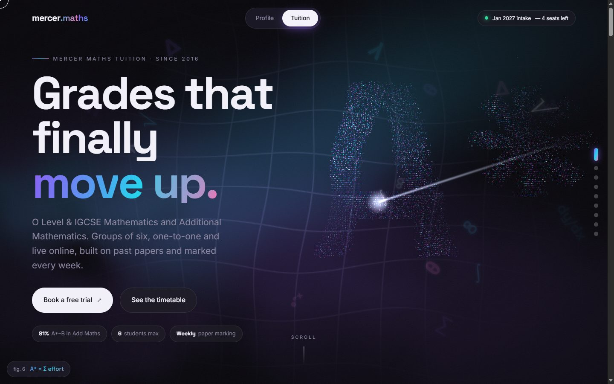
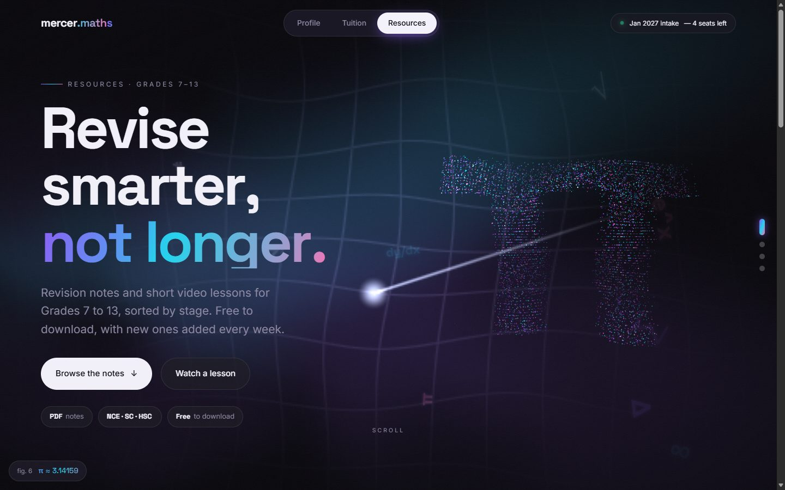
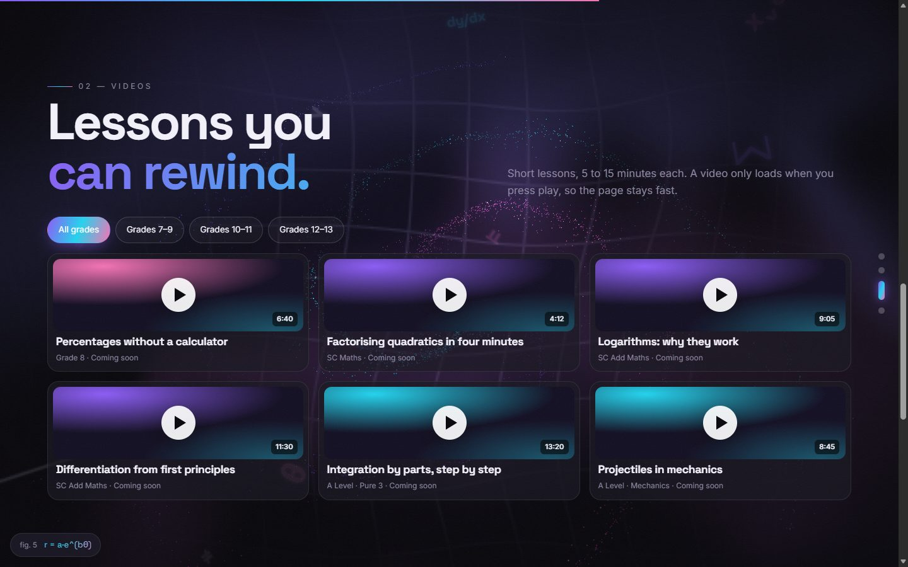
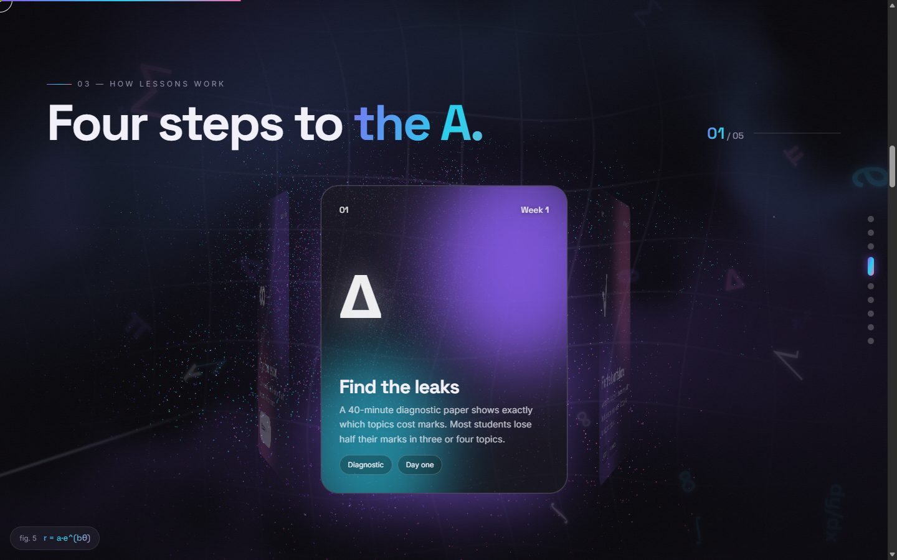

# Kavish Maths

**A 3D, animated three-page website for a Maths tutor in Mauritius: Grades 7–13 (NCE, SC, HSC) and SC Add Maths.**
Particles that morph through real equations, full-screen snap scrolling, a 3D lesson carousel,
an interactive timetable and a booking flow that writes the WhatsApp message for you.

**Live:** https://webluxe.github.io/mercer-maths/ &nbsp;·&nbsp; [Tuition](https://webluxe.github.io/mercer-maths/tuition.html) &nbsp;·&nbsp; [Resources](https://webluxe.github.io/mercer-maths/resources.html)

> **Demo content.** The tutor, results, prices, timetable and reviews are placeholders.
> Portrait photo by Fábio Lucas on Unsplash.


## Three pages

| Profile (`index.html`) | Tuition (`tuition.html`) |
|---|---|
|  |  |
| The tutor, results with a grade chart, the story, reviews, contact | Grades 7–13 by stage (NCE, SC, HSC), timetable, how lessons work, a worked example, quiz, fees, FAQ |

| Resources (`resources.html`) | |
|---|---|
|  |  |
| Revision notes (PDF) and video lessons, filterable by grade stage | Videos load only when you press play (privacy-friendly YouTube embed) |

Switching tabs plays a five-bar page transition; the next page builds itself out of it.

## Chapters and notes

The Resources page lists every chapter for Grades 7–13: Grade 7, Grade 8, Grade 9 NCE, O Level Maths 4024, Add Maths 4037 and A Level 9709 (Pure 1, Pure 3, Mechanics, Statistics). A chapter opens its notes in a reader on the page (PDF.js), so notes work on phones too.

- **Chapters** are listed in `tools/syllabus.cjs`.
- **Kavish's notes:** put the PDF in `assets/notes/<course>/` named like the chapter (e.g. `assets/notes/o-maths/16-variation.pdf`), or list any file name in that chapter's `files`. Then run `npm run build`, which prints which chapters have notes.
- **Demo notes** are written in `tools/notes-demo/<course>.json`. Run `npm run notes` to turn them into PDFs (needs Edge or Chrome).
- **Every other chapter** gets a labelled two-page sample PDF, made by the build.

## Adding videos

Videos come from **`assets/data/resources.json`**. Upload to YouTube (unlisted works), then set `"youtube"` to the video ID, the part after `watch?v=`. An empty `youtube` shows as *Coming soon*. `band` is one of `7-9`, `10-11` or `12-13`.

## Highlights


| | |
|---|---|
|  |  |
| **3D carousel.** Cards on a spinning cylinder, one card per scroll. | **Timetable.** Filter by grade band (cards flip in 3D), tap a slot to book it. |
|  |  |
| **Quiz.** Three real Add Maths questions with worked answers. | **Booking.** Three steps, then a ready-to-send WhatsApp or email. |

**Everything else:**
- **Stage lighting:** the page is near black, with one fan of light beams falling from the top, so what is lit reads as lit. Every panel change sends a band of light sweeping through the graph paper.
- **Hero:** a headline in three finishes (solid, outline, gradient) and two neon rings that orbit the portrait, one passing in front of him, each with a point of light racing round it.
- **The tutor in dots:** on the "about" panel the particles assemble into a halftone portrait of the tutor, sampled from the hero photo in the browser (swap the photo and the portrait follows). Behind the statement, giant outlined phrases cross the screen one after another.
- **Results:** one giant figure with the grade curve drawing itself behind it, and a chart whose top grades are lit and whose other bars dim when you point at one. As the panel lands, one ring of light stretches and splits into three, which land on the three smaller figures as they start to roll.
- **Story:** the years are giant outlined numerals that light up as the line reaches them, with a pulse of light travelling down the line.
- **Testimonial scanner:** the testimonial cards travel through a beam of light. Left of the beam a card is its "before" (a dashed outline with the grade the student started on); right of it, the same card in full colour with the grade they reached and their words. With reduced motion they are three plain quotes.
- **Staircase of cards:** the four cards that lead to the Tuition page arrive stacked as a staircase receding into the distance, then deal out into their row.
- **Cards:** dark glass with a hairline edge; each card in a row has its own corner light, which grows under the pointer.
- **Live 3D background:** aurora light, a rippling graph-paper grid, shooting stars and floating maths symbols. Each section has its own colour mood, and dust drifts past at different depths as you scroll.
- **Particle shapes:** a sphere, a torus knot, z = sin x · cos y, a saddle, a spiral, the tutor's portrait, and the words "A*", "KS" and "π". Each section owns one finished shape, and arriving there pours the particles straight from the last shape to the next in one smooth morph. They never pass through shapes in between, however fast you scroll. The particles twinkle, and glow hot while they are in flight. On desktop the pill in the bottom-left corner is a button: press it to pour them into the next shape.
- **Scroll speed drives the motion:** the grid warps, light streaks rush past, and the view widens like a warp jump. The particle cloud has weight: it lags behind a scroll and springs back, and the camera leans into every snap.
- **Click anywhere:** a shockwave ripples through the grid and the particles. **Hold the mouse down** and the particles fall toward the cursor while light gathers there; let go and they are thrown back out, harder the longer you held.
- **Snap scrolling:** one flick moves one full-screen section, with side dots (each names its section as you arrive) and keyboard support. Phones keep normal scrolling.
- **Zoom-through panels:** on desktop the section you leave grows past the camera and the next one is seen through a soft-edged round hole that opens from the middle of the screen. The particles dive with it: the shape you leave swells until you are inside it and its dots stream past, and the next shape comes out of the hole and grows into place. It follows the scroll, so it plays in both directions. On phones a change of shape plays a shorter dive.
- **Reveals:** headings rise letter by letter, the stats roll into place like a counter, chart bars shoot out with a spark on the tip, and the story timeline lights up node by node as its line is drawn.
- **Cursor effects:** a ring that stretches as it travels, squeezes on a press and names what a click will do (Book, Read, Open, Next); a comet trail; hero letters that lift as the cursor passes; holographic foil on the portrait; 3D tilt, glare and a lit edge on cards; and buttons that fill from the point where the pointer enters and drain where it leaves.
- **On phones:** the particles part around your finger, the scene leans as you tilt the phone, a tap leaves a ring where it landed, every control looks pressed the moment you touch it, and phones that can give a short buzz on a tap, a right answer or a mistake.
- **Page changes:** the particles rush outward as you leave a page and pour back in on the next, so the two read as one jump.
- **Small rewards:** a right quiz answer fills with a sweep and gets a tick, the final score rolls inside a ring, fee prices roll into place, and a finished booking lands its tick in a burst of symbols.
- **Sound, if you want it:** a round button in the bottom-right corner (desktop) turns on a soft soundscape: a note for every control you point at (slide along a row and it plays a little run), a whoosh between panels, chimes in the quiz, a tone that climbs while you hold the mouse down, and a quiet chord that changes with each section. It is off until you press it, it remembers your choice, and every sound is synthesised in the browser: there are no audio files.
- **Reduced motion:** with the system setting on there is no snap scrolling, the 3D scene no longer reacts to scrolling, holding or tilting, and headings, numbers and the timeline are simply there instead of animating in.


## Performance

The effects are heavy, so the site works hard to stay smooth:

- **Low-resolution background.** The animated background is drawn at 35% resolution and stretched to full screen. It's soft by nature, so the difference doesn't show.
- **Warm-up behind the loading screen.** The first time a browser draws a new kind of thing, the graphics card has to build a program for it, which froze a frame for about a tenth of a second the first time each section appeared. Every section is now drawn once, unseen, while the loading screen is up.
- **Sections are kept as pictures.** Each panel, and each block that animates inside it, is drawn once and then only moved, scaled and faded. Nothing is re-drawn while a panel zooms.
- **Adaptive quality.** It times the gap between 3D frames against the pace the screen sets (60fps for the 3D, also on 120Hz and 144Hz screens). If the typical frame runs a third late it steps the resolution down, then trims particles and drops the grain and trail. It raises quality again after four steady seconds, and remembers the level for the next visit. A single frozen frame never lowers it.
- **Light baseline.** 7,500 particles (3,500 on phones), a 2-octave background at 35% resolution, and a capped pixel ratio.
- **FPS meter.** Add `?fps` to the URL to see live numbers.
- **60fps 3D on fast screens.** The refresh rate is detected after start-up. On 120/144Hz screens the 3D renders at about 60fps while scrolling and the UI stay at full refresh.
- **Unloading engine.** Off-screen sections pause their CSS animations, and the scene throttles while the booking panel or video player covers it. Quality changes are applied only while nothing is moving, and particle trims fade instead of popping.
- **No rounded cuts round moving layers.** Cutting something that moves (rolling digits, a curve drawing itself, a zooming panel) to a rounded or circular shape makes the graphics card draw it through a mask, and building that mask froze a frame the first time. Rounded corners are drawn as rounded backgrounds instead, and the hole a panel arrives through is a soft mask that stays on until the panel is at rest.
- **No live blur.** There are no backdrop-filter blurs over the moving WebGL layer, and no per-frame repaints of animated gradients.
- **Small assets.** The photo is a 29 KB WebP with a JPG fallback, the JS is minified into one file, and the 3D library is preloaded.

## Project structure

```
index.html          Profile page
tuition.html        Tuition page
resources.html      Resources page (notes + videos)
assets/             What the site loads (built, don't edit by hand)
  css/style.css
  js/app.min.js
  img/              tutor.webp, tutor.jpg
  data/resources.json   the notes + videos list (edit this)
  notes/            note PDFs
src/                Source code
  js/               00-core.js … 27-setpieces.js, joined in filename order at build time (they share one scope)
                    00-core.js        set-up, and the event bus that lets features react to each other
                    01b-motion-kit.js shared helpers: rolling numbers, symbol bursts, reveals, phone buzz
                    04-scene.js       the 3D scene: shaders and the one render loop
                    06-scroll.js      scroll choreography: panel depth, headings, reveals, carousel
                    27-setpieces.js   the ring that splits into the results, the staircase of cards, the giant phrases
                    24-audio.js       the optional sound: a small synthesiser that listens to the event bus
  scss/             _abstracts.scss (tokens, mixins) + 35 partials, entry: style.scss
tools/test.cjs      Browser tests
docs/screenshots/   Images for this README
build.mjs           Build script
```

Features talk to each other through a small event bus (`bus.on` / `bus.emit` in `00-core.js`): a file announces what just
happened ("snap:go", "quiz:right", "charge:release", "tap"…) and others react without knowing who announced it.

## Develop

```bash
npm install        # once: PDF.js and the demo-notes renderer
npm run build      # chapters + notes, then src → assets (esbuild + sass, fetched via npx)
npm run notes      # demo notes JSON → PDFs
npm run serve      # http://127.0.0.1:4823
npm test           # browser tests on desktop + phone sizes (needs Edge or Chrome)
node tools/test.cjs laptops motion   # …or only the suites you name: desktop, desktop-small, laptops, phone, motion, touch, sound, offline, slow
```

Three.js, GSAP and Lenis are served from `assets/vendor/` (copied from `node_modules` by the build), so the site works even if a CDN is blocked. If the app can't start for any reason, the loader steps aside after 10 seconds instead of trapping the visitor.

Bookings go to WhatsApp **+230 5923 8436** (`src/js/13-booking.js` and the contact sections).

Built with [Three.js](https://threejs.org), [GSAP](https://gsap.com) + ScrollTrigger, [Lenis](https://lenis.darkroom.engineering) and Sass.
