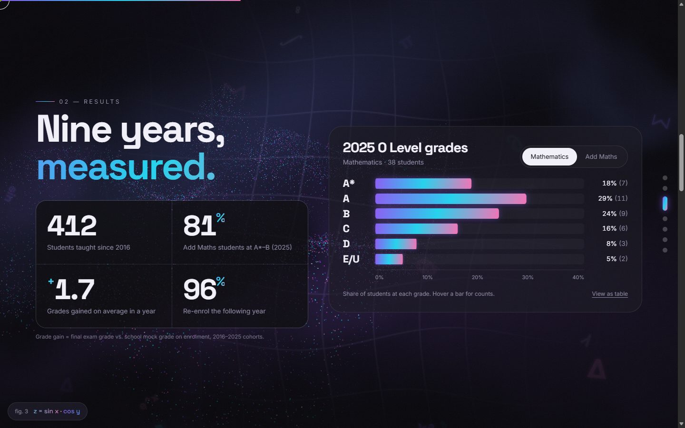
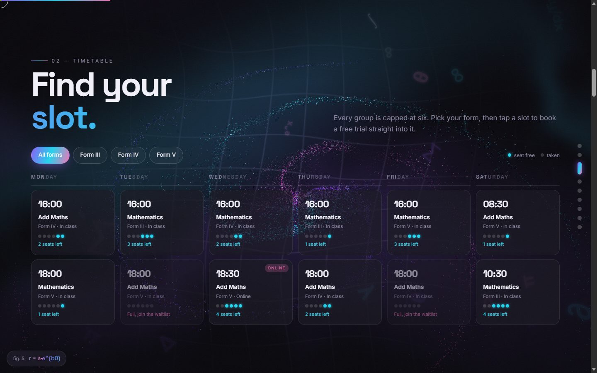
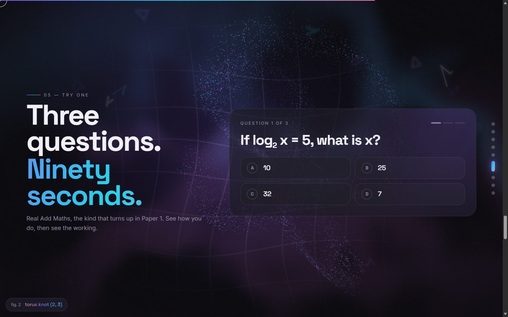
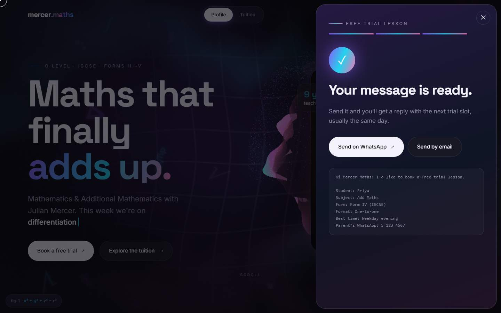
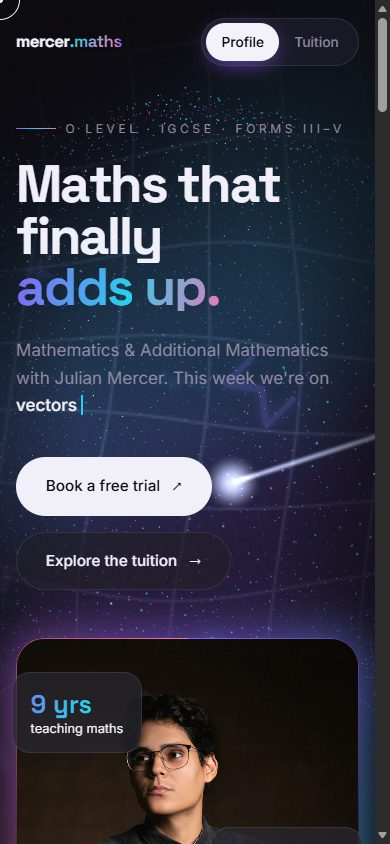

# Mercer Maths

**A 3D, animated two-page website for a Mathematics & Additional Mathematics tutor.**
Particles that morph through real equations, full-screen snap scrolling, a 3D lesson carousel,
an interactive timetable and a booking flow that writes the WhatsApp message for you.

**Live:** https://webluxe.github.io/mercer-maths/ &nbsp;·&nbsp; [Tuition page](https://webluxe.github.io/mercer-maths/tuition.html)

> **Demo content.** The tutor, results, prices, timetable and reviews are placeholders.
> Portrait photo by Fábio Lucas on Unsplash.


## Two pages

| Profile (`index.html`) | Tuition (`tuition.html`) |
|---|---|
|  |  |
| The tutor, results with a grade chart, the story, reviews, contact | Subjects, timetable, how lessons work, a worked example, quiz, fees, FAQ |

Switching tabs plays a five-bar page transition; the next page builds itself out of it.

## Highlights

| | |
|---|---|
|  |  |
| **3D carousel.** Cards on a spinning cylinder, one card per scroll. | **Timetable.** Filter by form (cards flip in 3D), tap a slot to book it. |
|  |  |
| **Quiz.** Three real Add Maths questions with worked answers. | **Booking.** Three steps, then a ready-to-send WhatsApp or email. |

**Everything else:**
- **Live 3D background:** aurora light, a rippling graph-paper grid, shooting stars and floating maths symbols.
- **Particle shapes:** a sphere, a torus knot, z = sin x · cos y, a saddle, a spiral, and finally the words "A*" and "JM".
- **Scroll speed drives the motion:** the grid warps, light streaks rush past, and the view widens like a warp jump.
- **Click anywhere:** a shockwave ripples through the grid and the particles.
- **Snap scrolling:** one flick moves one full-screen section, with side dots and keyboard support. Phones keep normal scrolling.
- **Cursor effects:** a comet cursor trail, hero letters that lift as the cursor passes, holographic foil on the portrait, 3D tilt and glare on cards, and a light inside every button.



## Performance

The effects are heavy, so the site works hard to stay smooth:

- **Half-resolution background.** The animated background is drawn at half resolution and stretched to full screen, about 75% less shader work with no visible difference.
- **Adaptive quality.** It watches the frame time. If frames slow down it lowers the 3D resolution in steps, then trims particles. It raises quality again when there's headroom.
- **60fps 3D on fast screens.** On 120/144Hz screens the 3D renders at about 60fps while scrolling and the UI stay at full refresh.
- **Unloading engine.** Off-screen sections pause their CSS animations, the whole animation clock sleeps in background tabs, and the scene throttles while the booking panel covers it.
- **No live blur.** There are no backdrop-filter blurs over the moving WebGL layer, and no per-frame repaints of animated gradients.
- **Small assets.** The photo is a 29 KB WebP with a JPG fallback, the JS is minified into one file, and the 3D library is preloaded.

## Project structure

```
index.html          Profile page
tuition.html        Tuition page
assets/             What the site loads (built, don't edit by hand)
  css/style.css
  js/app.min.js
  img/              tutor.webp, tutor.jpg
src/                Source code
  js/               00-core.js … 20-performance.js, joined in order at build time
  scss/             _abstracts.scss + 30 partials, entry: style.scss
docs/screenshots/   Images for this README
build.mjs           Build script
```

## Develop

```bash
npm run build      # src → assets (esbuild + sass, fetched via npx)
npm run serve      # http://127.0.0.1:4823
```

Built with [Three.js](https://threejs.org), [GSAP](https://gsap.com) + ScrollTrigger, [Lenis](https://lenis.darkroom.engineering) and Sass.
